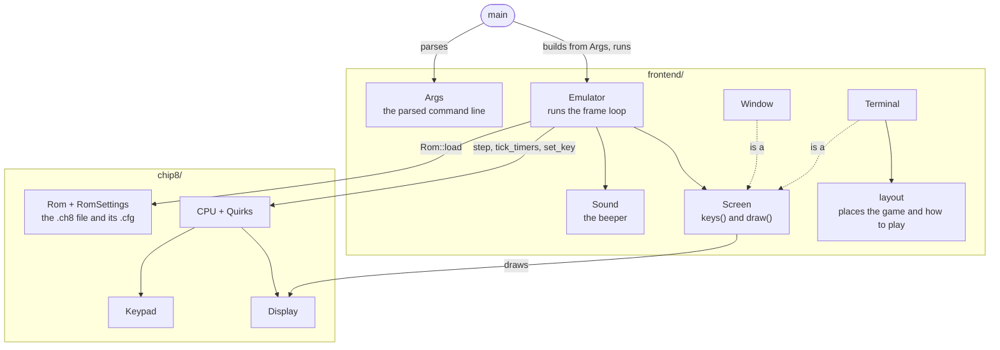
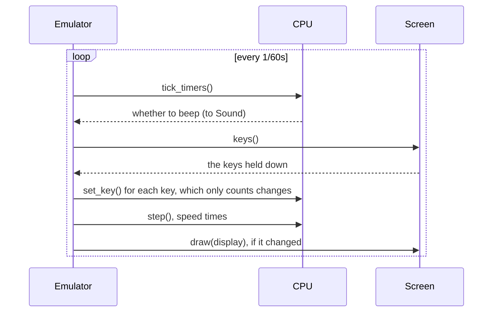

chip8
=====

A simple [CHIP-8](http://en.wikipedia.org/wiki/CHIP-8) and SUPER-CHIP emulator, implemented in more
than one language.

- [`cpp/`](cpp/) - the original C++ implementation (SDL3, googletest)
- [`rust/`](rust/) - a port of the same emulator to Rust (crossterm, minifb, rodio)
- [`go/`](go/) - a port of the same emulator to Go (x/term, Ebitengine, oto)
- [`web/`](web/) - the Rust core compiled to WebAssembly, to play in the browser, with a server
  that lets players share a link for others to watch them play live

The three native ones draw in the terminal they are started from by default, and can open a
separate window instead with `--display window`.

In the terminal, the game is centred, with the ROM's [how to play](#rom-settings) and the
[quirks](#quirks) and [speed](#speed) it runs with next to it in a terminal wider than it is tall
(counting a character as twice as tall as it is wide), or below it in a taller one, unless only
the other fits. A terminal of at least 130x35 shows the game at double
size: 128x32 characters, each showing 1x2 high resolution pixels as a half block. Smaller ones
show it as 64x16 characters, each showing 2x2 low resolution pixels as half blocks, or 2x4 high
resolution pixels as a braille character; that needs at least 66x19. The layout follows the
terminal when it is resized.

Freely licensed (CC0) ROMs to try them with are in [`roms/`](roms/), each with the
[settings](#rom-settings) it needs.

SUPER-CHIP
----------

Besides the original instruction set, the emulators run the
[SUPER-CHIP 1.1](http://devernay.free.fr/hacks/chip8/schip.txt) instructions:

- `00FF` / `00FE` switch to the 128x64 high resolution and back to 64x32, clearing the screen
- `00CN` scrolls down N pixels, `00FB` / `00FC` scroll right / left 4 pixels
- `DXY0` draws a 16x16 sprite, two bytes per row
- `FX30` points `I` at the 8x10 font for the digit in `VX`
- `FX75` / `FX85` save and restore `V0`..`VX` to the user flags (kept until the emulator quits)
- `00FD` exits, which stops the program, leaving the screen as it was

Like in [Octo](https://github.com/JohnEarnest/Octo), scrolling in low resolution moves whole
low resolution pixels, `DXY0` draws 16x16 sprites in either resolution, and a collision sets
`VF` to 1 rather than counting the colliding rows. Both resolutions are shown at the same
size, in the window and in the terminal.

Quirks
------

CHIP-8 interpreters disagree on a few instructions, and ROMs are written for one behaviour or
the other. Without quirks the emulators behave like SUPER-CHIP 1.1; each quirk turns on the
behaviour of the original COSMAC VIP interpreter or of Octo instead:

| Quirk        | Behaviour                                                              |
|--------------|------------------------------------------------------------------------|
| `shift`      | `8XY6`/`8XYE` shift `VY` into `VX`, instead of shifting `VX` in place  |
| `load-store` | `FX55`/`FX65` leave `I` pointing past the last register               |
| `vf-reset`   | `8XY1`/`8XY2`/`8XY3` reset `VF` to 0                                   |
| `jump-v0`    | `BNNN` jumps to `NNN + V0`, instead of `XNN + VX` (`X` being the top nibble) |
| `wrap`       | sprites wrap around the screen edges, instead of being clipped        |
| `vblank`     | `DXYN` waits for the next frame, so at most one sprite is drawn per frame |

A preset sets every quirk at once:

| Preset  | Quirks                                     | For ROMs written for                 |
|---------|--------------------------------------------|--------------------------------------|
| `octo`  | `shift,load-store,jump-v0,wrap`            | [Octo](https://github.com/JohnEarnest/Octo)'s defaults, like most modern homebrew (the default) |
| `vip`   | `shift,load-store,vf-reset,jump-v0,vblank` | the original COSMAC VIP interpreter  |
| `schip` | -                                          | SUPER-CHIP 1.1                       |

`--quirks` (`-quirks` in Go) takes a comma separated list of presets and quirks, applied from
left to right, starting from the default (`octo`). For example `--quirks vip`,
`--quirks vf-reset` (`octo` plus `vf-reset`) or `--quirks schip,shift` (SUPER-CHIP plus
`shift`).

`octo` is the default as it runs the most programs. Of the 76 CHIP-8 and SUPER-CHIP programs in
the [Chip8 Community Archive](https://github.com/JohnEarnest/chip8Archive), 64 were made for
exactly the `octo` quirks, 4 for `vip` and 4 for `schip`; the other 4 need a mix (see
[`roms/`](roms/) for examples). `octo` and `vip` share the instruction behaviour (`shift`,
`load-store` and `jump-v0`) that 71 of those programs and most classic ROMs rely on, and differ
only in the display (`wrap` against `vblank`) and in `vf-reset`.

Speed
-----

`--speed N` (`-speed` in Go) sets how many opcodes run per 1/60s frame. It defaults to 15 (900
per second): about half of the archive's programs ask for that or less, but SUPER-CHIP games
often want 100 or more.

ROM settings
------------

A ROM can have a settings file next to it: the ROM's path with its extension replaced by
`.cfg`, e.g. `roms/dinorun.cfg` for `roms/dinorun.ch8`. Each line is `name = value`, and lines
starting with `#` are comments:

    # from the Chip8 Community Archive, CC0
    title = Dino Run
    author = Andrezinrc
    about = Endless runner: jump over the obstacles for as long as you can.
    controls = W: start, jump, and restart after a crash
    quirks = vip

| Setting    | Value                                                                 |
|------------|-----------------------------------------------------------------------|
| `quirks`   | the [quirks](#quirks) the ROM needs, a list like `--quirks`           |
| `speed`    | the [speed](#speed) it needs, in opcodes per frame                    |
| `title`    | the game's name                                                       |
| `author`   | who made it                                                           |
| `about`    | what the game is and how to win; repeat it for more lines             |
| `controls` | a key and what it does, e.g. `A / D: move left / right`; one per key  |

Without `--quirks` or `--speed`, the emulators run the ROM with the quirks and speed from its
settings file, or the defaults for those it doesn't give. The other settings describe how to
play, which the terminal shows next to the game, along with the quirks and speed in use. The
quirks are shown as the shortest list that `--quirks` takes for them, e.g. `octo,vf-reset`.

References for the bytecodes used is from :

- http://en.wikipedia.org/wiki/CHIP-8
- http://devernay.free.fr/hacks/chip8/schip.txt

Keyboard
--------

All implementations map the 16-key hex keypad to the left of a QWERTY keyboard, keeping the
layout of the original COSMAC VIP keypad, and quit on `Esc`:

    1 2 3 4        1 2 3 C
    Q W E R   ->   4 5 6 D
    A S D F        7 8 9 E
    Z X C V        A 0 B F

So `W` `A` `S` `D` are 5, 7, 8 and 9, which most games use for up, left, down and right (classic
ones laid out for the VIP keypad use 2, 4, 6 and 8: `2` `Q` `E` `S`). It is the same layout as
[Octo](https://github.com/JohnEarnest/Octo) and most other emulators.

Architecture
------------

The three native ports are built the same way, with the core in a `chip8` directory and
everything that touches the terminal, a window or the speaker in `frontend/` beside it. The
names below are the C++ and Rust ones; Go's are the same in its own casing (e.g. `LoadRom`).

The `Emulator` loads the `Rom`, and runs it with the quirks and speed given on the command
line, otherwise the ones from the ROM's settings file, otherwise the defaults. Go has no
`Screen` type, as Ebitengine runs the window's loop: its terminal and window each drive the
`Emulator` instead. Every frame goes the same way; `set_key` ignores a key whose state didn't
change, so `FX0A` only ever sees a fresh press, however a frontend reports its keys:

The [web version](web/) reuses the Rust core: its WebAssembly module runs the same `CPU`, with
the browser as the screen, keyboard and speaker, and its server lists the ROMs with
`RomSettings::load`.
